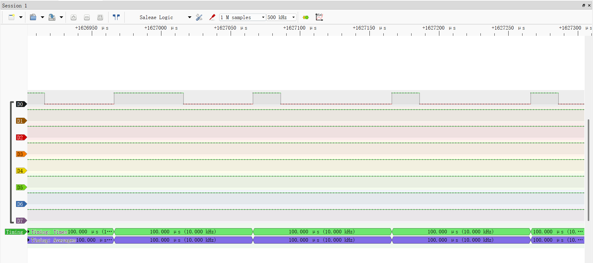

# H 桥关断瞬间：短路刹车 vs 断路滑行

## 1. 这是什么
有刷电机 PWM 关断瞬间，绕组电流必须找到出路。TB6612 真值表里
IN1/IN2 = 1,1（短路刹车）和 0,0（断路滑行）的物理本质。

## 2. 原理
电机绕组 = 电感 + 电阻，转动时是发电机（反电动势 E∝转速）。
电感电流不能突变，关断后必须续流。

| IN1/IN2 | 回路状态 | 电流衰减 | 转速结果 |
|---|---|---|---|
| 1,1 | 绕组两端接GND，小电阻闭环 | 慢（τ=L/R） | 急刹：被短路的发电机憋出大电流，楞次定律反扭 |
| 0,0 | MOS全关，借体二极管回到VM | 快（被12V反顶） | 滑行：开路只剩摩擦 |

PS：【τ=L/R】τ（时间常数 单位s），L越大，对电流阻碍越强，电流变化越慢，τ越大；反之R越大，能量耗散越快，电流变化越快，τ越小。

- 短路刹车：1,1时，本质就是形成回路感应电流阻碍线圈的运动。（解析：1,1意味着线圈自身两端相连短路，电机变成了发电机，根据楞次定律和切割磁感线，从线圈转子旋转切割永磁铁时的原有磁场靠近回路会产生电流（称感应电流）而产生新磁场。而因为原磁场的变化让回路里的磁通量变了，回路想维持原来的状态，所以感应电流的磁场阻碍磁通量的变化。随机惯性转子被磁场牵拉摩擦发热，由动能转为了热量，由此停下转动（刹车）。）
- 断路滑行：0,0无法形成回路，自然没有感应电流出现，转子随惯性慢慢转完。
- 记忆钩子：电流死得越慢，刹车越狠。

## 3. 证据

- 图1：50%↔20% 占空比切换瞬间，高电平宽度突变（500kHz 采样）
推论：PWMA 接法下每个周期关断相都是一次微型刹车，
所以占空比→平均电压严格线性 = VM×duty。

## 4. 踩坑 / 延伸
- 一开始把两个方向记反了：名字里的“快/慢衰减”说的是电流，不是转速
- 待验证（M2）：手指捏轴分别置 1,1 和 0,0，应该能摸出“抱死”和“空转”两种手感
- 延伸：BLDC 的“快衰减/慢衰减”是六步换向里的概念，阶段二会见到的同族知识