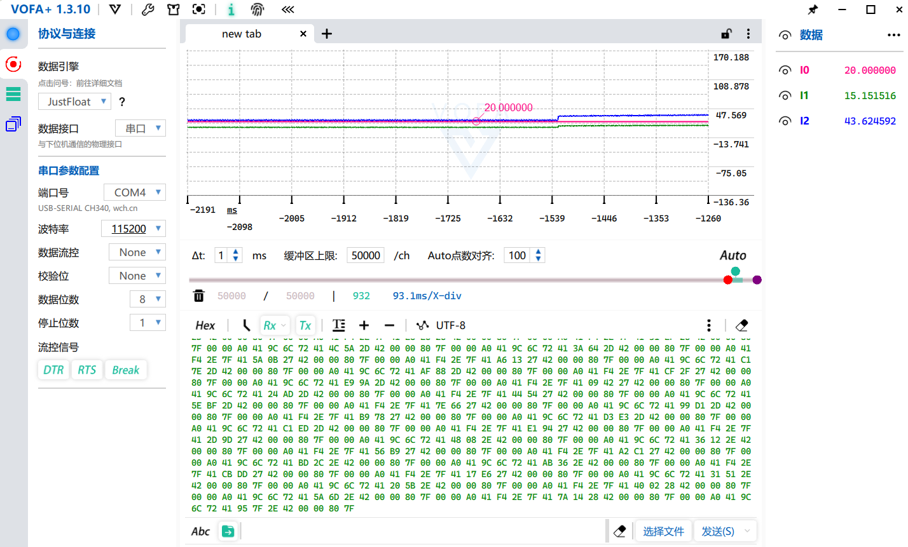
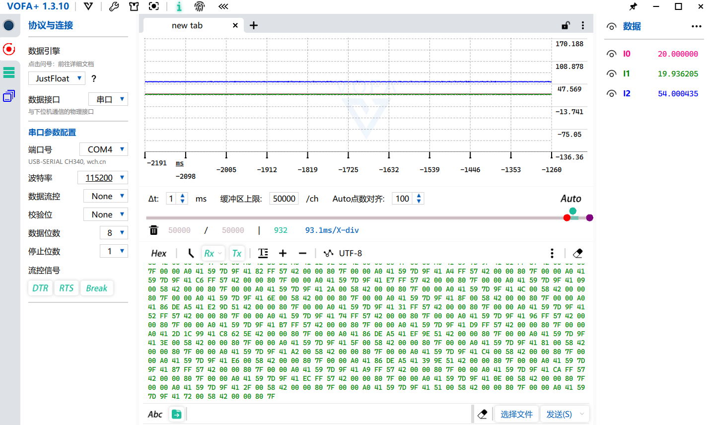
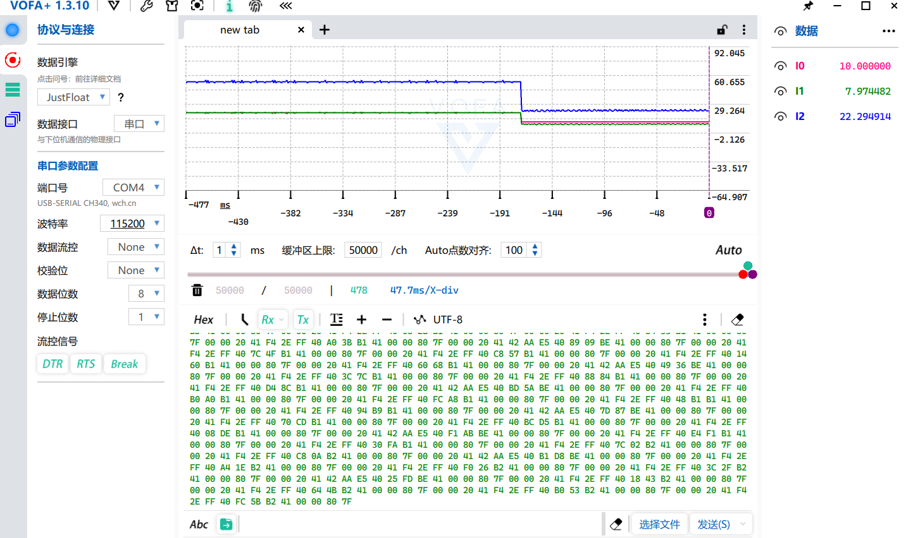
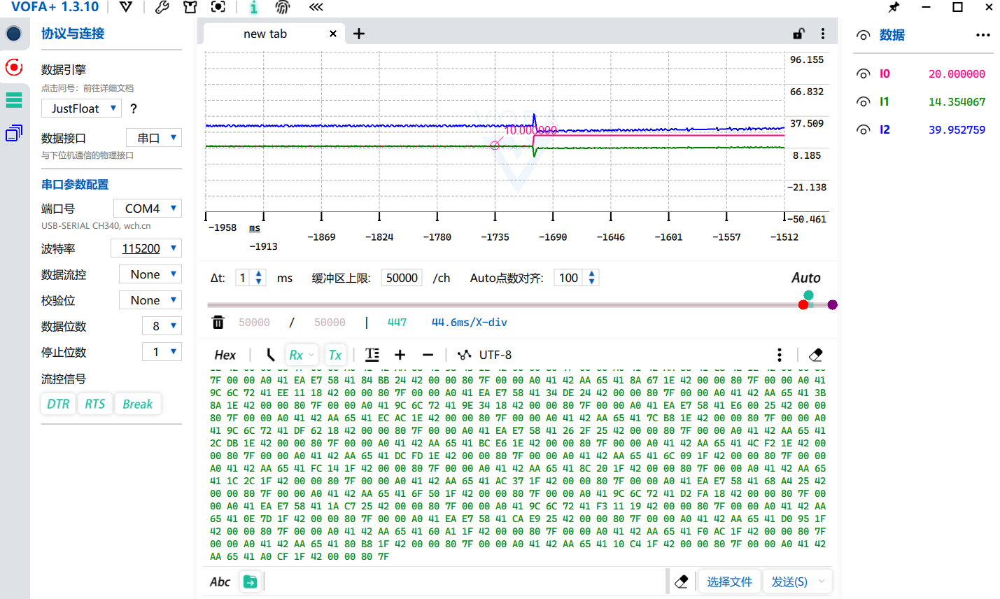
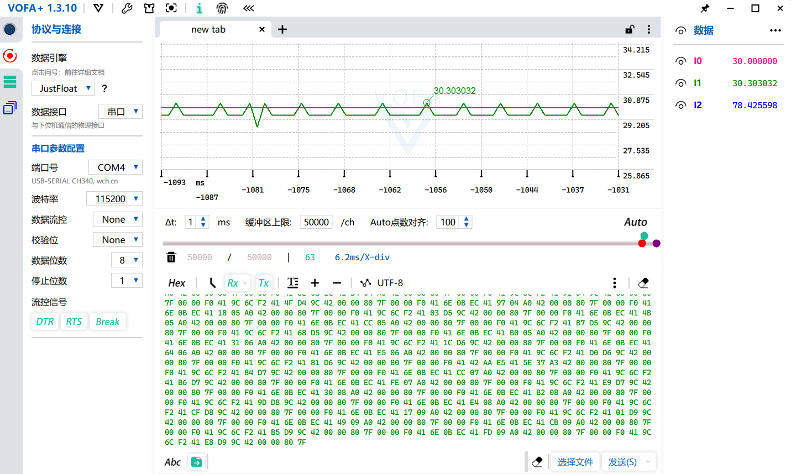

# M4：有刷电机速度闭环 PI 控制

## 目标
在正确标定的编码器换算系数下，实现 10~20 RPM 的速度闭环，静差 <1 RPM。

## 最终参数
| 参数 | 值 | 说明 |
|---|---|---|
| Kp | 2.0 | 起调推力 |
| Ki | 0.2 | 静差补偿 |
| Kaw | 0.5 | 反算增益 |
| 积分上限 int_max | 400 (80/Ki) | 积分水库盖子 |
| 输出限幅 | ±100 | 双向驱动 |
| 采样周期 | 10 ms | TIM4 中断 |
| 编码器换算 | 11×171×4=7524 counts/rev | 减速比 171 为推算值（6000÷35），待独立验证 |

## 截图
- 
- 
- 
- 
- 

## 关键发现
1. **35 不是减速比**：商家标 35 RPM 是空载转速，而推算减速比为 171:1
2. **积分累积问题**：原思路 int_max=out_max/Ki 允许积分攒满 100%，但导致冲过头后卸不掉，所以抗饱和方式从“条件积分”优化为“反算式”
3. **单向地板极限环**：旧结构占空比地板=0，超调时环想要负力矩但给不了，所以引入了有符号的“duty = -pwm_out;”

## 烧录注意事项
- 先确认 TIM2 为 Encoder Mode TI1+TI2（4 倍频）
- AIN1/AIN2 方向以 pwm 正→计数增为准