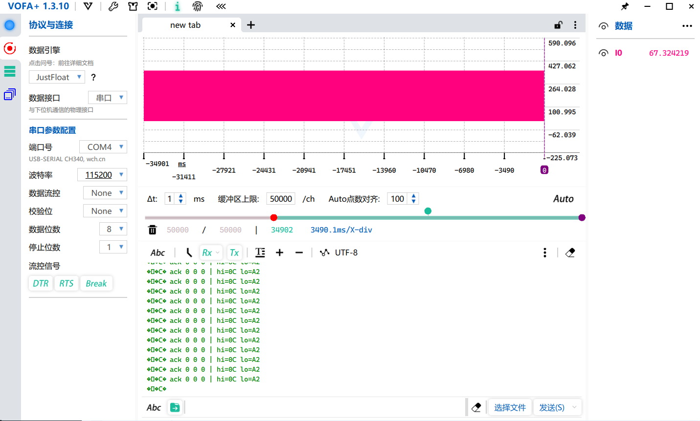

# M6  软件模拟 I2C + AS5600 磁编码器（练手通信）

## 0. 前言
手搓软件 I2C（GPIO bit-bang），与 AS5600 磁编码器通信读 12 位角度，
转动电机轴用 VOFA+(JustFloat) 观测角度实时变化。这是无刷阶段前的**通信练手**。

## 1. 目标
- 不用硬件 I2C，纯手工用 GPIO 模拟出 SCL/SDA 时序，能稳定读到 AS5600 角度
- 转动电机轴，VOFA+ 上的角度应随转动单调变化（0~359.9° 绕一圈）
- 用逻辑分析仪(30元) + PulseView 核对时序波形
- 本质：掌握「写一个能用的底层通信协议」的能力，为 P2 六步换相课外题

## 2. 硬件接线与上拉
| 信号 | 引脚 | 方向 | 说明 |
|---|---|---|---|
| SCL | PB6 | 推挽输出 | 时钟线，MCU 强驱动（硬件上有上拉，不影响推挽）|
| SDA | PB7 | 开漏输出 | 数据线，配合 2 个外部上拉电阻实现线与、双向读 |
| ADDR | 接地 | - | AS5600 从机地址 = 0x36（7bit）|

> 两个上拉电阻把 SCL/SDA 拉到 3.3V，I2C 靠它实现「谁都能拉低、谁都不能强推高」的线与逻辑。

## 3. 设计要点（软件模拟 I2C）

### 3.1 时序元语（i2c_start / i2c_stop）
- start：SDA_H → SCL_H → **SDA_L**(在 SCL 高时拉低 SDA 产生起始)→ SCL_L
- stop ：SDA_L → **SCL_H → SDA_H**(在 SCL 高时拉高 SDA 产生停止)
- 关键：起始/停止的标志是 **SCL=1 期间 SDA 的跳变**，
  平时必须在 SCL=0 时才能动 SDA，SCL_H期间需保持SDA状态稳定

### 3.2 写字节 + 读 ACK（I2C_WriteByte）
- 从 MSB 到 LSB 依次摆 SDA → 拉高 SCL（从机在上升沿采样）→ 拉低 SCL 换下一位
- 8 位结束后 MCU **释放 SDA(读方向)**，再打第 9 个 SCL 脉冲读从机回 ACK(0)/NACK(1)
PS: MSB(Most Significant Bit)：一个字节中的最高有效位，也就是Bit7，如010111011，先发最左的0；
    LSB(Least Significant Bit):一个字节中的最低有效位，如上面二进制中最右边的1。

### 3.3 读字节 + 发 ACK（I2C_ReadByte）
- 先释放 SDA（写高，交给从机驱动），每个 SCL 高电平读 1 位
- 最后 MCU 主动发 ACK：读最后一个字节前发 NACK(1) 通知从机"别再发了"

### 3.4 DWT 微秒延时（I2C_DelayUs）
- 用 DWT->CYCCNT 做 CPU 周期计数延时，n us = n × (SYSCLK/1e6) 个周期
- **必须调用 DWT_Delay_Init()**  else → cycles_per_us=0，延时塌成 0，时序全乱

## 4. 里程碑上踩的坑（重点）
> 这次从“恒定高电平”一直查到“VOFA+ 波形不动”，三个问题层层叠叠，每个都可独立成教训。

1. **GPIO 漏设 Speed → 引脚其实是"输入"（根因，导致 SCL/SDA 恒定高电平）**
   `GPIO_InitTypeDef = {0}` 清零后只设 Pin 和 Mode，没设 Speed。
   STM32F1 里 MODE[1:0]=00 表示**输入模式**，而非输出
   → 引脚实际是浮空输入(CNF=00 甚至模拟输入)，GPIO 写 ODR 拉不低
   → SCL/SDA 被 2 个上拉电阻钳在 3.3V，逻辑分析仪/万用表看都是恒定高电平，不会有变化。
   √ 修复：输出模式必须显式给 `Speed = GPIO_SPEED_FREQ_LOW`。这是本阶段**最重要的教训**。

2. **DWT_Delay_Init 被注释 / 没调 → 延时失效**
   `cycles_per_us` 默认 0，`while(DWT->CYCCNT < us*0)` 立即成立，等于没延时，
   软件 I2C 以极限速度（71MHz）乱跑，时序不可靠。

3. **JustFloat 波形不动，但 printf 文本在动（VOFA+ 显示问题）**
   串口上**同时**跑 printf(ASCII 文本) 和 Vofa_SendJustFloat(二进制 float+帧尾) 两路。
   JustFloat 是纯二进制协议，printf 的 ack/hi/lo 文本字节混进去被当作 float 数据吞掉，
   帧对齐彻底打乱 → 角度解析不出来，波形永远不动。
   而 printf 文本本身会原样显示在下方控制台，所以位于下面的文本数字有反应。
   √ 修复：跑 JustFloat 波形时，**串口里绝不能混 printf 文本**。

## 5. 实测结果
> 转动电机轴时：
> - [angle_rotation.png](angle_rotation.png) VOFA+ JustFloat 波形：角度随转动单调变化、绕满360°      （359.9° （4095×360/4096≈359.91））
> - [i2c_bus_wave.png](i2c_bus_wave.png) 逻辑分析仪 PulseView：SCL 有规则时钟、SDA 有数据变化、可见 start/stop/ACK
> -  Vofa_SendJustFloat与printf串口上同时跑的情况

| 验证项 | 现象 |
|---|---|
| SCL 波形 | 有稳定的时钟脉冲，不再恒定高（说明已成功初始化为输出） |
| SDA 数据 | 每次读取有 start→地址→ACK→数据→stop 完整帧 |
| 转动跟随 | 转一圈角度 0→359.9°，反转变为减小，正反向都正常 |
| VOFA+ 实时性 | 波形图随转动实时刷新（JustFloat，串口 115200） |

## 6. 标准（如何算合格）

------------ 标准 ------------
| # | 标准 | 状态 |
|---|---|---|
| 1 | 手搓 start/stop/写字节/读字节 全通，无硬件 I2C | √ |
| 2 | GPIO 正确配成 推挽(SCL)/开漏(SDA) + Speed 完整 | √ |
| 3 | 角度随转动单调变化、可绕满一圈 | √（见波形截图）|
| 4 | 逻辑分析仪能清晰看到 SCL/SDA 时序与 ACK | √ |
| 5 | VOFA+ JustFloat 实时显示角度波形 | √ |
| 6 | 能独立定位"恒定高电平"与"波形不动"的根因 | √（见第 4 节）|

------------ 波形图 ------------
| 截图 | 配置 | 现象 |
|---|---|---|
| [angle_rotation.png](angle_rotation.png) | VOFA+ JustFloat，115200 | 角度随转轴实时变化、绕满一圈|
| [i2c_bus_wave.png](i2c_bus_wave.png) | 逻辑分析仪 PulseView | 完整 I2C 帧：start/地址/ACK/数据/stop|
| [stuck_high_wave.png](stuck_high_wave.png) | 出问题时的波形(恒定高) | 反面教材：两根线被上拉钳死、无任何翻转|

**结论：M6 通过。** 手搓软件 I2C 成功通信 AS5600，角度跟随可靠，三大坑（输入坑/延时坑/JustFloat 污染坑）已定位并修复。

## 7. 相关
- 教训专题：`docs/notes/comm/i2c_software_gpio_lessons.md`
- 下一步（P2）：无刷六步换相。由于当前驱动板无电流采样，先掌握必要的换相逻辑；
  等过渡到有感 FOC，再根据进度置换带电流采样的驱动板，引入电流环。