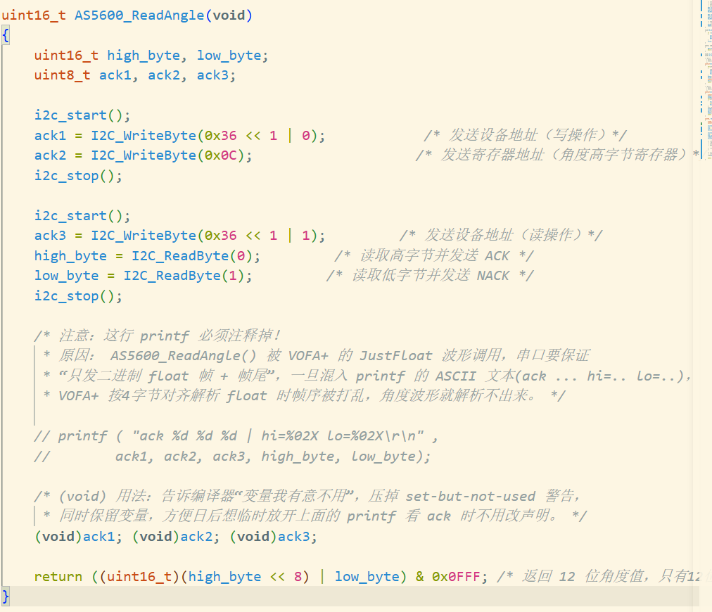

# 软件模拟 I2C + GPIO 踩坑笔记（M6 通信练手）

> 分类：communication (comm)。本页记录在 M6 手搓软件 I2C 时踩到的坑与原理，
> 未来长时间不看后回来能快速回忆。

## 1. 程序 结构（最快找回记忆）
```
i2c_soft.c
  i2c_soft_init()     手动配置 PB6(SCL 推挽)/PB7(SDA 开漏) + 拉空闲置高
  DWT_Delay_Init()    初始化 DWT 周期计数延时（必须先调用）
  I2C_DelayUs(us)     DWT->CYCCNT 基于 CPU 周期的微秒延时
  i2c_start()/stop()  start=SCL高拉低SDA；stop=SCL高释放SDA
  I2C_WriteByte(d)    MSB先出，每bit SCL上升沿让从机采样，第9拍读ACK
  I2C_ReadByte(ack)   释放SDA，SCL高读bit，最后回ACK(0)/NACK(1)
  AS5600_ReadAngle()  8bit地址+寄存器0x0C → 高字节; 再读低字节 → 拼12位
```
- AS5600 从机地址 0x36(7bit)，写 0x6C、读 0x6D；角度寄存器 0x0C(高字节)/0x0D(低字节)
- 角度 = ((hi<<8)|lo) & 0x0FFF，除以 4096 × 360° 得度数

## 2. 核心原理
- **开漏(OD) 为什么配 SDA**：开漏输出只能"拉低/释放"，释放时靠上拉电阻回到高。
  这样实现：任一设备想发 0 就拉低总线，多个设备不冲突（线与，有0全0）。读数据时能释放让从机驱动。
- **推挽(PP) 配 SCL**：时钟线只有主机一个能动，推挽强驱动高/低都迅速、干净。
- **起始/停止条件**：SCL=1 期间 SDA 的跳变。平时 SDA 必须在 SCL=0 时才允许变化。
- **ACK 机制**：传输 8 位后由接收方在第 9 个 SCL 上把 SDA 拉低=ACK。主机读最后一个字节前发 NACK，从机收到 NACK 就停止发送。

## 3. 三大坑（按时间顺序，M6 全程）

### 问题 A：`GPIO_InitTypeDef = {0}` 没设 Speed → 引脚是"输入"不是"输出" 最重要
- **现象**：万用表/逻辑分析仪 SCL/SDA 都恒定 3.3V，转轴也没反应，还以为是"没初始化/磁铁不对"。
- **原因**：`{0}` 把结构体清零，忘了设 `Speed`。STM32F1 里 CRL/CRH 的 4 位配置
  = MODE[1:0] + CNF[1:0]。`Speed=0` → **MODE[1:0]=00 = 输入模式**，CNF=00 甚至算模拟输入。
  输出函数里 `config = Speed + CNF_OUTPUT_PP`，Speed 是 0 就配出个输入。
  → GPIO 写 ODR 对输入模式无拉低作用（引脚不驱动，外部读不到） → 总线被上拉电阻钳在高。
- **判断**：只要引脚配置时看到 `HAL_GPIO_Init` 但没提供 Speed，输出就不成立。
- **修复**：输出模式**必须**加 `GPIO_InitStruct.Speed = GPIO_SPEED_FREQ_LOW;`（或 HIGH/MEDIUM）。
  MX 生成的 gpio.c 每次都带 Speed，所以"换 MX 就好了"——因为是 MX 补上了 Speed。

### 问题 B：DWT_Delay_Init 没调用 → 延时塌成 0
- 若 `cycles_per_us=0`，`while(DWT->CYCCNT < us*0)` 条件立即成立，等于没有任何延时，
  软件 I2C 以极限速度乱跑，时序不稳、偶发失败。
- 修复：调用顺序 `DWT_Delay_Init()` → 再进主循环。

### 问题 C：JustFloat 波形不动，但能看见 printf 文本 → 串口数据混流
- **现象**：VOFA+ 上角度波形/数值不动，但下面控制台 printf 的 `ack hi=.. lo=..` 文本在变。
  （这其实证明 I2C 通了，hi/lo 确实在读变化，只是角度没被 JustFloat 显示出来。）
- **原因**：同一根串口同时发 printf(ASCII) 和 Vofa_SendJustFloat(二进制 float+帧尾 00 00 80 7F)。
  JustFloat 按 4 字节对齐解析 float，printf 的 ASCII 字节混进去被打成 float 数据，帧对齐乱掉。
- **修复**：跑 JustFloat 波形时，串口只准发二进制帧，所有 printf 调试文本必须注释掉。

## 4. 小技巧：`(void)var;` 压掉未使用警告、保留变量
- 注释 printf 后 `ack1/2/3` 变成 set-but-not-used，GCC 会警告。
- 写法 `(void)ack1; (void)ack2; (void)ack3;` 表示"我有意不用"，压警告又不删变量，
  日后想临时放开 printf 看 ack 时声明不用改。当然这里为了简洁代码，便优化了原代码，不再赘述了。


## 5. 快速排查清单（下次遇到通信问题按序查）
1. 上电量 SCL：若恒定高且用手转轴没波形 → 查 GPIO 是不是被配成了输入（看 Speed）
2. 若 SCL 有脉冲但 SDA 无 → 查地址/寄存器/是否开漏+上拉
3. 若收发都对但上位机不动 → 查是否串口混了 printf、协议是不是对的 JustFloat/波特率