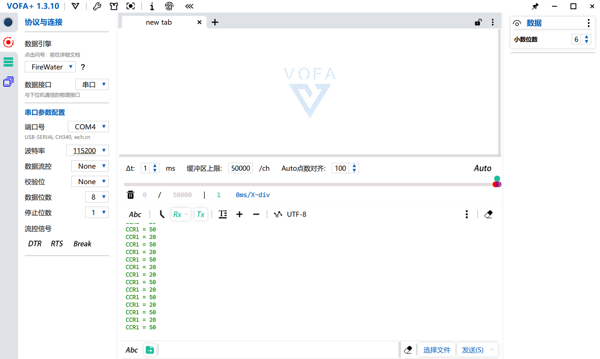

# printf 重定向到串口（retarget）

## 1. 摘要
MCU没有屏幕，newlib的字符输出默认是空壳。目标：让printf的
输出从USART1出去，PC端用CH340及VOFA+ 查看。

## 2. 原理（一个插座，各种电器）
调用链：printf → C库 _write() → __io_putchar()
- 工具链预留了 __io_putchar 这个"插座"（声明并调用，但不定义）.
- 我提供"电器"：HAL_UART_Transmit(&huart1, ...) 发一个字节.
- 概念：retarget（重定向）———— 提供库预留的最底层输出函数.

## 3. 验证
- .
- 解码：43 43 52 31 20 3D 20 32 30 0D 0A → "CCR1 = 20"                         （此处为16进制转为10进制后对照ASCII码表，0D=CR 0A=LF，\r\n 的初见）.
- 切文本模式（FireWater）后，human-readable.

## 4. 坑&总结
- 把 __io_putchar 拼成 __in_putchar → GCC implicit declaration
  ———— 警告时一律当错误对待.
- “__io_putchar”是"定义后被动被库调用"，不能自己调它.
- 接线：CH340 TX→PA10、RX→PA9（交叉），共地，电源脚全空.
- volatile：ISR 和 main 共享的变量（flag_ pid）必须加，
  防编译器把它缓存进寄存器导致 main 看不到中断的修改.